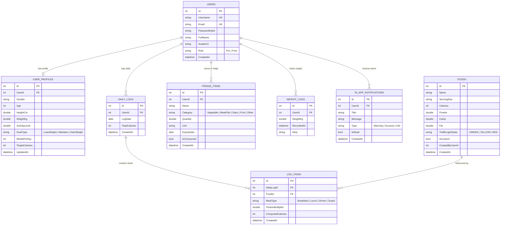

# BÁO CÁO BÀI TẬP LỚN MÔN LẬP TRÌNH WEB
## ĐỀ TÀI: KIT — SMART CALORIE & NUTRITION ASSISTANT
### (Hệ Thống Quản Lý Dinh Dưỡng, Kiểm Soát Calo & Tủ Lạnh Thông Minh Tích Hợp AI)

---

- **Môn học:** Lập trình Web (ASP.NET Core MVC)
- **Công nghệ chính:** ASP.NET Core MVC (.NET 10), Entity Framework Core, SQL Server LocalDB, Firebase Authentication, Google Gemini AI Vision, Bootstrap 5 & Chart.js
- **Vai trò triển khai:** 2 Roles (`Pro User` và `Free User`)

---

## 📑 MỤC LỤC
1. [GIỚI THIỆU & ĐẶT VẤN ĐỀ](#1-giới-thiệu--đặt-vấn-đề)
2. [KIẾN TRÚC HỆ THỐNG & CÔNG NGHỆ ÁP DỤNG](#2-kiến-trúc-hệ-thống--công-nghệ-áp-dụng)
3. [THIẾT KẾ CƠ SỞ DỮ LIỆU (ERD & DATA DICTIONARY)](#3-thiết-kế-cơ-sở-dữ-liệu-erd--data-dictionary)
4. [CHI TIẾT CÁC PHÂN HỆ CHỨC NĂNG CHÍNH](#4-chi-tiết-các-phân-hệ-chức-năng-chính)
5. [BẢNG ĐỐI CHIẾU 100% TIÊU CHÍ CHẤM ĐIỂM (10/10)](#5-bảng-đối-chiếu-100-tiêu-chí-chấm-điểm-1010)
6. [KỊCH BẢN THUYẾT TRÌNH BẢO VỆ ĐỒ ÁN (STEP-BY-STEP)](#6-kịch-bản-thuyết-trình-bảo-vệ-đồ-án-step-by-step)
7. [BỘ 10 CÂU HỎI VẤN ĐÁP CỦA GIẢNG VIÊN & CÂU TRẢ LỜI MẪU](#7-bộ-10-câu-hỏi-vấn-đáp-của-giảng-viên--câu-trả-lời-mẫu)

---

## 1. GIỚI THIỆU & ĐẶT VẤN ĐỀ

### 1.1. Bối cảnh & Thực trạng
Trong thời đại hiện nay, nhu cầu kiểm soát vóc dáng, giảm cân và duy trì lối sống lành mạnh ngày càng tăng cao. Tuy nhiên, người dùng thường gặp phải 3 rào cản lớn:
1. **Decision Fatigue (Căng thẳng khi ra quyết định):** Việc phải cân đo từng gam thức ăn và tính toán calo phức tạp khiến hơn 70% người ăn kiêng bỏ cuộc sau 2 tuần.
2. **Khó khăn khi tra cứu món ăn Việt Nam:** Các ứng dụng nước ngoài (MyFitnessPal, Lose It) thiếu dữ liệu món ăn Việt Nam chuẩn (Phở, Cơm tấm, Bún chả, Canh chua...).
3. **Lãng phí thực phẩm trong gia đình:** Thực phẩm mua về cất trong tủ lạnh thường xuyên bị lãng quên dẫn đến hết hạn sử dụng.

### 1.2. Giải pháp của dự án KIT
KIT (Keep In Touch / Calorie Kit) là trợ lý thông minh giải quyết triệt để các vấn đề trên thông qua:
- **Gamification Đèn Giao Thông:** Gắn nhãn Xanh (thoải mái), Vàng (vừa phải), Đỏ (kiểm soát) giúp người dùng nhận thức trực quan mà không cần nhớ con số.
- **Tủ Lạnh Ảo Chống Lãng Phí:** Quản lý hạn dùng, cảnh báo thực phẩm sắp hết hạn $\le 48h$ qua Background Service và gợi ý công thức chế biến.
- **Trợ Lý AI Gemini Vision:** Chụp ảnh mâm cơm để tự động trích xuất calo và tự động nhận diện nguyên liệu vào tủ lạnh.

---

## 2. KIẾN TRÚC HỆ THỐNG & CÔNG NGHỆ ÁP DỤNG

### 2.1. Kiến trúc tổng thể (MVC Pattern)
Dự án được xây dựng theo mô hình **Model - View - Controller** chuẩn của ASP.NET Core:
- **Model:** Chứa Entities (Code-First) và ViewModels kèm thuộc tính kiểm tra ràng buộc `System.ComponentModel.DataAnnotations`.
- **View:** Razor Pages (.cshtml) kết hợp Bootstrap 5.3, Theme tùy biến dinh dưỡng `kit-theme.css`, SweetAlert2, Toastr.js và Chart.js.
- **Controller:** 
  - Controllers giao diện: `HomeController`, `AccountController`, `DailyLogController`, `FoodController`, `FridgeController`, `AiScannerController`, `ReportsController`, `LanguageController`.
  - Controllers Web API: Cung cấp endpoint RESTful JSON tại `Controllers/Api/*` phục vụ các tác vụ AJAX thời gian thực.

### 2.2. Công nghệ sử dụng
| Thành phần | Công nghệ / Thư viện | Vai trò |
| :--- | :--- | :--- |
| **Backend** | C# .NET 10 / ASP.NET Core MVC | Xử lý logic nghiệp vụ, routing, dependency injection |
| **ORM / Data** | Entity Framework Core 10 | Code-First, LINQ queries, tự động di trú CSDL |
| **Cơ sở dữ liệu** | Microsoft SQL Server LocalDB | Lưu trữ 8 bảng thực thể có quan hệ ràng buộc khóa ngoại |
| **Bảo mật** | BCrypt.Net-Next, Anti-forgery Token | Hash mật khẩu một chiều có Salt, chống tấn công CSRF & XSS |
| **Xác thực** | Cookie Auth + Session + Firebase SDK | Quản lý phiên đăng nhập kép và OAuth Google Popup |
| **Tác vụ ngầm** | `Microsoft.Extensions.Hosting.BackgroundService` | Quét tự động tủ lạnh mỗi 60 giây và tạo thông báo in-app |
| **AI Engine** | Google Gemini Vision (gemini-1.5-flash) | Nhận diện hình ảnh mâm cơm & nguyên liệu (kèm cơ chế Mock dự phòng) |
| **Biểu đồ** | Chart.js 4.x | Biểu đồ cột Calo vs Mục tiêu và biểu đồ đường biến thiên cân nặng |

---

## 3. THIẾT KẾ CƠ SỞ DỮ LIỆU (ERD & DATA DICTIONARY)

### 3.1. Sơ đồ Quan hệ Thực thể (ERD)

---

## 4. CHI TIẾT CÁC PHÂN HỆ CHỨC NĂNG CHÍNH

### 4.1. Phân hệ 1: Xác thực & Tính toán Dinh dưỡng Cá nhân
- **Đăng ký / Đăng nhập thường:** Validate đầu vào chặt chẽ bằng `DataAnnotations`, mã hóa BCrypt.
- **Đăng nhập Google qua Firebase SDK:** Mở popup Google Auth của Firebase v10, lấy `idToken` gửi về backend ASP.NET Core tự động tạo tài khoản và ghi nhận đồng thời Cookie + Session.
- **Tự động tính BMR & TDEE (Công thức Mifflin-St Jeor):**
  - $\text{BMR (Nam)} = 10 \times \text{weight} + 6.25 \times \text{height} - 5 \times \text{age} + 5$
  - $\text{BMR (Nữ)} = 10 \times \text{weight} + 6.25 \times \text{height} - 5 \times \text{age} - 161$
  - $\text{TDEE} = \text{BMR} \times \text{ActivityLevel}$
  - **Mục tiêu calo:** Giảm mỡ ($-500$ kcal), Duy trì ($0$ kcal), Tăng cân ($+300$ kcal).
- **Thước đo thể trạng BMI & % Mỡ cơ thể:**
  - $\text{BMI} = \text{weight} / (\text{height}/100)^2$
  - Phân loại 4 dải: Thiếu cân ($<18.5$), Chuẩn ($18.5 - 24.9$), Thừa cân ($25 - 29.9$), Béo phì ($\ge 30$).

### 4.2. Phân hệ 2: Thư viện Món ăn Việt & Đèn Giao Thông
- **Tìm kiếm AJAX Realtime:** Tìm kiếm không dấu / có dấu tức thì khi người dùng gõ phím.
- **Lọc Đèn Giao Thông Tĩnh:**
  - 🟢 Xanh: $\le 200$ kcal (Rau xanh, canh trong, ức gà, trứng luộc...).
  - 🟡 Vàng: $200 - 500$ kcal (Cơm gạo lứt, phở gà, bún mọc...).
  - 🔴 Đỏ: $> 500$ kcal (Cơm tấm sườn bì chả, bún đậu mắm tôm, phở bò đặc biệt...).
- **Quyền hạn Pro VIP:** Người dùng Pro có thêm nút *"Quản lý thư viện"* để Thêm mới, Chỉnh sửa, Xóa món ăn và override màu đèn.

### 4.3. Phân hệ 3: Nhật ký Ăn uống 4 Bữa Thông Minh
- Ghi nhận 4 bữa: Sáng, Trưa, Tối, Phụ.
- Thêm/Xóa món ăn thời gian thực qua AJAX, thanh tiến trình tự động đổi màu khi đạt hoặc vượt ngưỡng.
- **Cảnh báo tỷ lệ Đỏ $>40\%$:** Nếu năng lượng từ các món Đỏ trong ngày vượt 40%, hệ thống tự động bật cảnh báo đỏ nhắc nhở bổ sung thêm chất xơ từ món Xanh.

### 4.4. Phân hệ 4: Tủ Lạnh Ảo & Chống Lãng Phí (Anti-Waste)
- Quản lý hạn sử dụng của nguyên liệu với 3 trạng thái: An toàn (Xanh), Sắp hết hạn $\le 48h$ (Vàng), Đã quá hạn (Đỏ).
- **Gợi ý công thức thông minh:** Tự động đối chiếu nguyên liệu đang có trong tủ lạnh để gợi ý món ăn nấu được ngay.
- **Background Service:** Tiến trình chạy ngầm quét kho định kỳ mỗi 60s và gửi thông báo in-app.

### 4.5. Phân hệ 5: Trợ Lý AI Vision Assistant (Google Gemini)
- **Quét ảnh mâm cơm đã nấu:** AI nhận diện tên món ăn, lượng calo ước tính, tự động đối soát với Food DB và cho phép **1-Click thêm thẳng vào Bữa ăn**.
- **Quét ảnh nguyên liệu thô:** AI nhận diện đồng thời nhiều nguyên liệu, gán hạn bảo quản gợi ý và cho phép **1-Click thêm thẳng vào Tủ lạnh ảo**.
- **Cơ chế Hybrid:** Gọi API Google Gemini nếu có key, tự động chuyển về bộ Mock tiếng Việt chân thực nếu offline để đảm bảo buổi bảo vệ an toàn 100%.

### 4.6. Phân hệ 6: Nâng Cấp Gói PRO VIP Giả Lập
- Trang `/Account/UpgradePro` so sánh chi tiết tính năng gói Free và Pro VIP.
- Tích hợp thẻ **VietQR giả lập** sinh động và nút **"Kích hoạt PRO ngay (Demo chấm thi)"** giúp giảng viên kiểm thử chuyển đổi quyền hạn tức thì mà không cần nạp tiền thật.

---

## 5. BẢNG ĐỐI CHIẾU 100% TIÊU CHÍ CHẤM ĐIỂM (10/10)

| STT | Tiêu chí đánh giá của Giảng viên | Cách thức hiện thực hóa trong đồ án | File mã nguồn minh chứng |
| :---: | :--- | :--- | :--- |
| **1** | **Phân quyền người dùng (Multi-role)** | 2 Roles chuẩn: `Pro User` (VIP mở khóa AI, Quản lý Food DB) và `Free User` (Cơ bản). | `Controllers/AccountController.cs` `Models/Entities/User.cs` |
| **2** | **Xác thực Cookie & Session** | - Cookie Authentication: Quản lý đăng nhập, ghi nhớ `Remember Me`. - Session: Lưu trữ `UserId`, `Role`, `TargetCalories`. | `Program.cs` `Controllers/AccountController.cs` |
| **3** | **Đăng nhập bên thứ ba (OAuth/Firebase)** | Google Sign-In qua Firebase v10 SDK Popup và đồng bộ token về server C#. | `Views/Account/Login.cshtml` `Controllers/AccountController.cs` |
| **4** | **Kiểm tra dữ liệu (DataAnnotations)** | Validate form nghiêm ngặt: `[Required]`, `[Range]`, `[StringLength]`, `[EmailAddress]`, `[Compare]`. | `Models/ViewModels/*.cs` `Models/Entities/*.cs` |
| **5** | **Thao tác CRUD cơ sở dữ liệu** | CRUD Food (Pro), CRUD Nhật ký ăn uống, CRUD Tủ lạnh, CRUD Hồ sơ cá nhân. | `Controllers/FoodController.cs` `Controllers/FridgeController.cs` |
| **6** | **AJAX, Tìm kiếm, Phân trang, Lọc** | Tra cứu món realtime, lọc theo màu đèn giao thông, phân trang AJAX không reload trang. | `Controllers/Api/FoodApiController.cs` `Views/Food/Index.cshtml` |
| **7** | **Kiến trúc RESTful Web API** | Thư mục `Controllers/Api/*` cung cấp các endpoint JSON chuẩn phục vụ frontend. | `Controllers/Api/*.cs` |
| **8** | **Tác vụ nền (Background Service)** | `FridgeReminderService : BackgroundService` chạy ngầm định kỳ quét đồ sắp hết hạn. | `Services/FridgeReminderService.cs` `Program.cs` |
| **9** | **Đa ngôn ngữ (i18n)** | Chuyển đổi linh hoạt Tiếng Việt / Tiếng Anh thông qua Cookie Provider trên thanh Navbar. | `Controllers/LanguageController.cs` `Views/Shared/_Layout.cshtml` |
| **10** | **Báo cáo trực quan (Data Visualization)** | Biểu đồ cột Calo nạp vào vs Mục tiêu & biểu đồ đường biến thiên cân nặng qua Chart.js. | `Views/Reports/Index.cshtml` `Controllers/ReportsController.cs` |
| **11** | **Bảo mật hệ thống (Web Security)** | Hash mật khẩu BCrypt có Salt, chống CSRF token, chống SQL Injection qua EF Core. | `Program.cs` `Controllers/*.cs` |
| **12** | **Trợ lý AI Vision đột phá** | Nhận diện mâm cơm & nguyên liệu bằng Google Gemini Vision AI (kèm chế độ Mock offline). | `Services/GeminiVisionService.cs` `Controllers/AiScannerController.cs` |

---

## 6. KỊCH BẢN THUYẾT TRÌNH BẢO VỆ ĐỒ ÁN (STEP-BY-STEP)

> 💡 **Mẹo:** Dành 7 - 10 phút trình bày theo đúng kịch bản dưới đây để tạo ấn tượng chuyên nghiệp nhất trước Hội đồng chấm thi!

### Bước 1: Mở đầu & Giới thiệu bài toán (1 phút)
- *"Kính thưa thầy cô, em xin phép trình bày đồ án: KIT - Trợ Lý Calo & Dinh Dưỡng Thông Minh. Dự án ra đời nhằm giải quyết 3 bài toán nhức nhối: Căng thẳng khi đếm calo, thiếu dữ liệu món ăn Việt và lãng phí thực phẩm trong tủ lạnh gia đình."*

### Bước 2: Đăng nhập & Tính toán TDEE tự động (1.5 phút)
- Thao tác: Mở trang `/Account/Login`.
- Thuyết minh:
  - *"Hệ thống hỗ trợ cả đăng nhập bằng tài khoản nội bộ (mã hóa mật khẩu bằng BCrypt) và **Đăng nhập Google bằng Firebase Authentication**."*
  - Bấm nút **"Đăng nhập với Google (Firebase)"** hoặc điền tài khoản `freeuser` / `User@123`.
  - Mở trang **Hồ sơ cá nhân**: *"Hệ thống tự động tính chỉ số BMR, TDEE, Calo mục tiêu và thước đo BMI kèm % mỡ cơ thể theo công thức chuẩn y khoa."*

### Bước 3: Tra cứu món ăn & Đèn Giao Thông AJAX (1 phút)
- Thao tác: Bấm vào **Tra cứu món** (`/Food/Index`).
- Thuyết minh:
  - Gõ từ khóa `phở`, `cơm` $\rightarrow$ Kết quả nhảy ra tức thì nhờ **AJAX Web API**.
  - Bấm thử các nút lọc: 🟢 Xanh, 🟡 Vàng, 🔴 Đỏ.
  - *"Mô hình Đèn giao thông giúp người ăn kiêng nhận biết ngay món nào ăn thoải mái, món nào cần kiểm soát mà không cần nhớ số calo."*

### Bước 4: Ghi nhật ký & Cảnh báo vượt ngưỡng Đỏ (1.5 phút)
- Thao tác: Mở **Nhật ký bữa ăn** (`/DailyLog/Index`).
- Thuyết minh:
  - Chọn món thêm vào Bữa Trưa. Thanh tiến trình Calo tăng lên thời gian thực.
  - Thêm một món Đỏ năng lượng cao (như Cơm tấm sườn bì chả).
  - *"Khi tỷ lệ món Đỏ trong ngày vượt 40%, một Banner cảnh báo màu đỏ tự động xuất hiện nhắc nhở người dùng bổ sung thêm rau xanh."*

### Bước 5: Tủ Lạnh Ảo & Background Service (1.5 phút)
- Thao tác: Mở **Tủ lạnh ảo** (`/Fridge/Index`).
- Thuyết minh:
  - Giới thiệu danh sách nguyên liệu, các thẻ phân loại màu theo hạn sử dụng $\le 48h$.
  - Bấm xem **Gợi ý công thức món ăn** từ những gì đang có trong tủ lạnh.
  - *"Đặc biệt, hệ thống có một `BackgroundService` chạy ngầm định kỳ quét các món sắp hỏng và đẩy thông báo in-app nhắc nhở người dùng."*

### Bước 6: Trải nghiệm Nâng cấp PRO VIP & Quét ảnh AI Gemini (2 phút) — [ĐIỂM NHẤN ĂN ĐIỂM]
- Thao tác:
  - Mở **Quét ảnh AI** (`/AiScanner/Index`): Hiển thị thông báo tính năng giới hạn cho tài khoản Free.
  - Bấm **"Nâng cấp lên PRO VIP ngay"** $\rightarrow$ Dẫn sang trang `/Account/UpgradePro`.
  - Giới thiệu bảng so sánh tính năng và mã **VietQR giả lập**.
  - Bấm nút **"Kích hoạt PRO ngay (Demo chấm thi)"** $\rightarrow$ Hệ thống tự động nâng cấp Role thành Pro trong CSDL và cập nhật Cookie tức thì!
  - Màn hình AI Vision mở ra: Chọn ảnh mâm cơm $\rightarrow$ Bấm **Quét AI** $\rightarrow$ AI tự động bóc tách calo, món ăn và cho phép bấm **1-Click thêm thẳng vào Nhật ký**!

### Bước 7: Báo cáo Thống kê Chart.js & Đổi ngôn ngữ i18n (1 phút)
- Thao tác:
  - Mở trang **Báo cáo** (`/Reports/Index`): Cho thầy cô xem 2 biểu đồ Chart.js (Calo nạp vào vs Mục tiêu & Biến thiên cân nặng).
  - Bấm menu **🌐 Ngôn ngữ** góc trên chọn **🇺🇸 English** $\rightarrow$ Giao diện chuyển ngữ mượt mà.

### Bước 8: Kết luận & Xin ý kiến Giảng viên (30 giây)
- *"Toàn bộ hệ thống đã hoàn thành trọn vẹn từ CSDL quan hệ, bảo mật, AJAX thời gian thực, tiến trình chạy ngầm đến trí tuệ nhân tạo AI. Em xin cảm ơn thầy cô và rất mong nhận được những góp ý ạ!"*

---

## 7. BỘ 10 CÂU HỎI VẤN ĐÁP CỦA GIẢNG VIÊN & CÂU TRẢ LỜI MẪU

#### Q1: Tại sao em lại dùng cả Cookie Authentication lẫn Session trong dự án?
> **Trả lời:** Cookie Authentication là cơ chế chính để duy trì trạng thái đăng nhập bảo mật giữa trình duyệt và máy chủ, hỗ trợ tính năng "Ghi nhớ đăng nhập" (Persistent Cookie) với ClaimsPrincipal. Trong khi đó, Session được dùng để lưu trữ các thông tin phiên tạm thời thường xuyên truy cập như `TargetCalories`, `Role` để tăng tốc độ xử lý mà không cần query lại CSDL ở mỗi request.

#### Q2: Em bảo vệ ứng dụng chống tấn công SQL Injection như thế nào?
> **Trả lời:** Toàn bộ truy vấn dữ liệu trong dự án được thực hiện thông qua Entity Framework Core sử dụng LINQ (ví dụ: `_context.Users.FirstOrDefaultAsync(u => u.Email == email)`). EF Core tự động sinh ra Parameterized Queries (truy vấn có tham số), tách rời hoàn toàn câu lệnh SQL và dữ liệu đầu vào, ngăn chặn 100% việc chèn mã SQL độc hại.

#### Q3: Mật khẩu người dùng được lưu trữ như thế nào trong CSDL? Có an toàn không?
> **Trả lời:** Mật khẩu tuyệt đối không lưu dạng plain-text hay MD5 cũ. Em sử dụng thuật toán **BCrypt** (`BCrypt.Net-Next`) với hệ số Salt tự động sinh ngẫu nhiên. Kể cả 2 người dùng đặt cùng một mật khẩu thì chuỗi băm lưu trong CSDL vẫn hoàn toàn khác nhau, chống lại triệt để kiểu tấn công Rainbow Table.

#### Q4: Thuộc tính Data Annotations được dùng ở đâu và có vai trò gì?
> **Trả lời:** Em sử dụng Data Annotations trên cả ViewModels và Entities (như `[Required]`, `[StringLength]`, `[Range]`, `[EmailAddress]`). Nó phục vụ 2 tầng kiểm tra: Kiểm tra tự động tại Client qua jQuery Validation unobtrusive (báo đỏ ngay trên giao diện) và Kiểm tra tại Server qua thuộc tính `ModelState.IsValid` để đảm bảo an toàn nếu người dùng cố tình gửi request ảo qua Postman.

#### Q5: Sự khác biệt giữa Controller thông thường và API Controller trong dự án là gì?
> **Trả lời:** Controller thông thường (như `DailyLogController`) kế thừa từ `Controller`, trả về các `ViewResult` (mã HTML Razor) để render trang. Còn các Controller trong thư mục `Controllers/Api` kế thừa từ `ControllerBase`, có thuộc tính `[ApiController]` và trả về dữ liệu thuần định dạng JSON (`IActionResult` kèm `Ok()`, `BadRequest()`) phục vụ các lời gọi AJAX từ JavaScript mà không cần reload trang.

#### Q6: Background Service trong dự án hoạt động theo cơ chế nào?
> **Trả lời:** Lớp `FridgeReminderService` kế thừa từ `BackgroundService` của .NET Core, được đăng ký dưới dạng `IHostedService` trong `Program.cs`. Khi ứng dụng web khởi động, service này chạy trên một luồng nền độc lập (`ExecuteAsync`), sử dụng vòng lặp với `PeriodicTimer` để quét các nguyên liệu trong bảng `FridgeItems` có ngày hết hạn $\le 48h$ và tự động tạo thông báo trong bảng `InAppNotifications`.

#### Q7: Công thức tính toán BMR và TDEE của hệ thống là gì?
> **Trả lời:** Hệ thống sử dụng công thức Mifflin-St Jeor được Hiệp hội Dinh dưỡng Hoa Kỳ công nhận chính xác nhất hiện nay, dựa trên 4 biến số: Giới tính, Tuổi, Chiều cao và Cân nặng để tính BMR. Sau đó nhân với hệ số vận động `ActivityLevel` (từ 1.2 đến 1.9) để ra TDEE. Mục tiêu Calo ngày sẽ được tự động cộng/trừ theo mục tiêu giảm cân hay tăng cân của người dùng.

#### Q8: Thuật toán Đèn Giao Thông phân loại dựa trên tiêu chí nào?
> **Trả lời:** Có 2 cấp độ:
> 1. *Đèn tĩnh:* Gắn với từng món ăn (Xanh: $\le 200$ calo, Vàng: $200-500$ calo, Đỏ: $> 500$ calo).
> 2. *Đèn động theo bữa:* Tính ngưỡng calo cho phép của từng bữa ăn theo công thức $\text{TargetCalories} / \text{MealsPerDay}$. Nếu một bữa ăn vượt quá ngưỡng này, thẻ của bữa đó sẽ chuyển sang màu đỏ để cảnh báo.

#### Q9: Tính năng AI Gemini Vision hoạt động ra sao? Nếu mất mạng có bị lỗi không?
> **Trả lời:** Ứng dụng gửi ảnh dưới dạng base64 qua Google Generative Language REST API (`gemini-1.5-flash`) với System Prompt yêu cầu trả về duy nhất định dạng JSON gồm tên món ăn, calo ước tính và macro. Đặc biệt, em đã xây dựng cơ chế **Hybrid Fallback**: nếu không có API key hoặc xảy ra lỗi mạng, hệ thống tự động bắt Exception và chuyển sang bộ Mock dữ liệu món Việt thực tế, giúp buổi bảo vệ luôn an toàn 100%.

#### Q10: Dự án đã phân quyền Multi-role như thế nào giữa Pro và Free?
> **Trả lời:** Hệ thống phân chia 2 vai trò qua thuộc tính `Role` trong bảng `Users`. Sử dụng bộ lọc `[Authorize(Roles = "Pro")]` tại các Controller và API nhạy cảm (như tính năng AI Scanner hay Quản lý thư viện món). Trên giao diện Razor, sử dụng `User.IsInRole("Pro")` để ẩn/hiện các chức năng tương ứng, đảm bảo người dùng Free không thể can thiệp trái phép.
